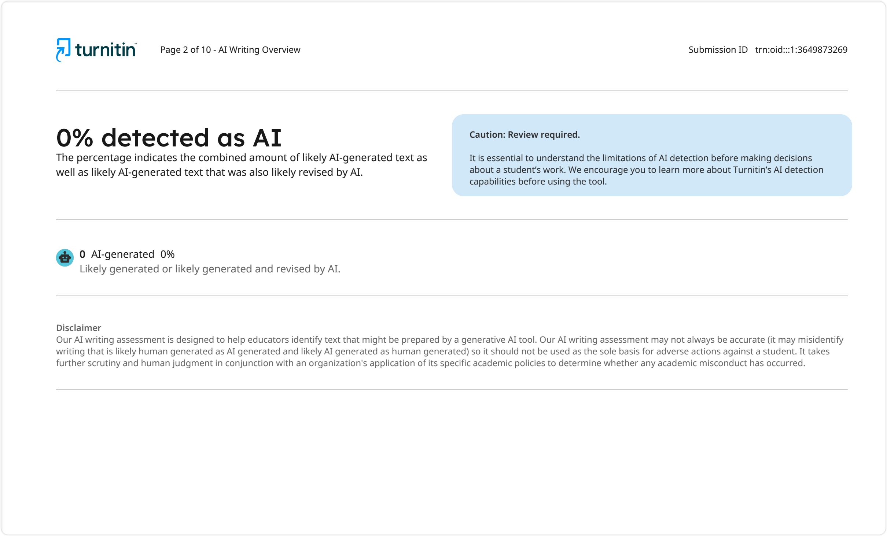
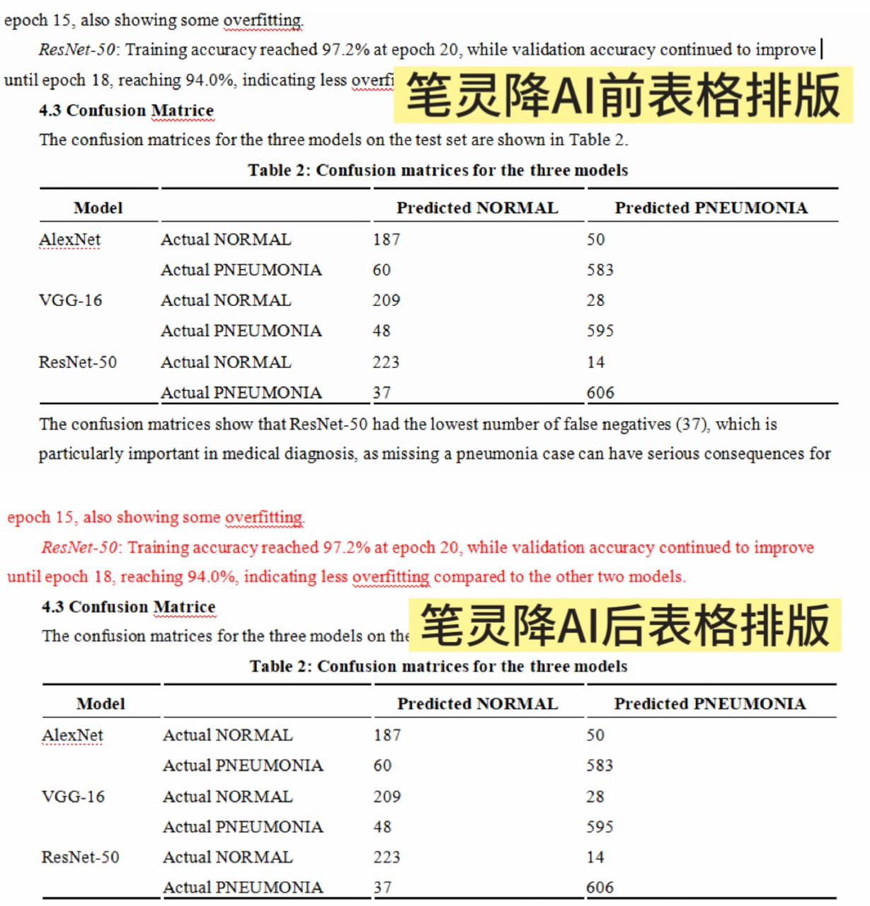
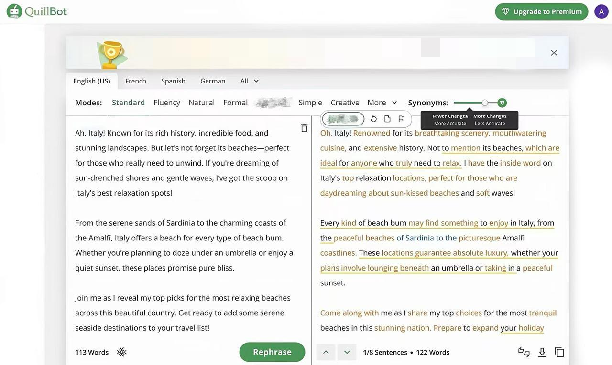
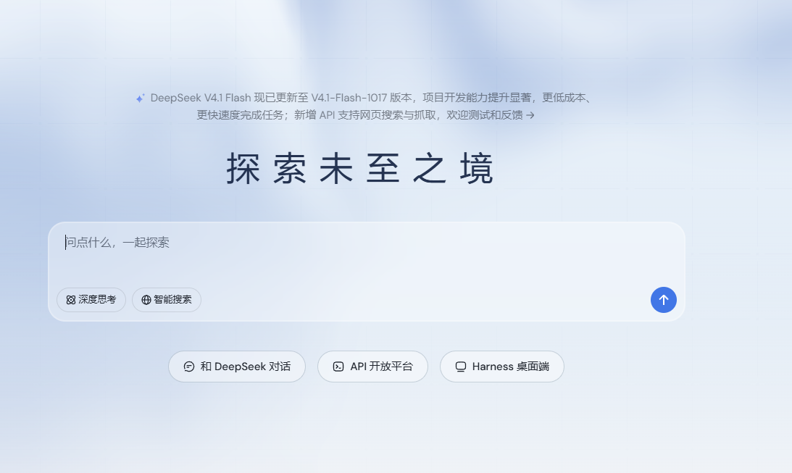
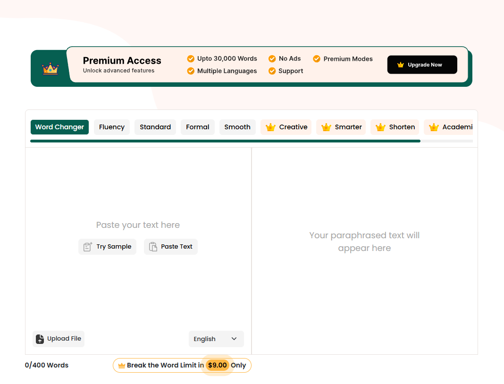

# 2026实测：6款英文降ai率工具对比，轻松搞定降AI率（附手动技巧）

明明全篇都是自己逐字敲出来的，只是因为平时积累的句式太工整、用词太规范，结果提交系统检测时，AI疑似率就高得离谱。

如果自己盲目替换词汇，不仅容易改丢原意，还会破坏上下文的逻辑连贯性，想要高效做好**英文降ai**，挑对一款适配稿件类型的**英文降ai率工具**，往往能省去大半精力。

近期我集中测试了十几款热门英文改写软件，最终筛选出6款具有代表性的产品，按照深度精修、地道润色、初筛排查三个维度进行横向对比。

这份合集同时涵盖了专业软件与**英文免费降ai率工具**，无论你是想找靠谱的**英文降低ai率**方案，还是想先体验**英文降aigc**实际效果，都可以直接参考这篇实测。

# **一、深度精修类（重塑自然语感，稳步压低AI特征）**

适合：AI检测数值偏高的英文稿件，核心需求是在保留专业表达与原意的基础上，优化行文节奏。

## **1、笔灵英文降AI**

**官网：**[**https://u\.ibiling\.cn**](https://ibiling.cn/paper-pass/english?from=githubywjiangai1009jw)**（网页版打开体验更佳）**

**优势**：国内网络可直接打开的**英文降ai率工具**，也是我在多轮**英文ai降ai**实测中综合表现最稳妥的一款。针对高AI标记的英文长文，它能够深入调整机械化的句式衔接，改写后检测数值回落明显且自然。

它支持docx和txt格式文档直接批量上传，万字长文无需分段复制，操作时可以提前锁定专业名词、公式和参考文献不被改动，处理完成后还能完整保留原有的文档排版，极大提升了批量改稿效率，个人觉得这一点是很有用也很人性化的。

**局限性**：遇到极个别冷门交叉学科的生僻词时，偶发措辞不够地道的情况，建议全文处理完后人工快速核对一遍核心术语。

**适合人群**：手头英文稿件字数多、需要保留复杂格式，追求省心且稳定**英文降ai率**效果的小伙伴。

## **2、StealthWriter**

**官网**：[https://stealthwriter\.ai/](https://stealthwriter.ai/)

**优势**：海外专注文本去痕的改写工具，支持生成多个不同版本的修改草稿，鼠标点击单句还能实时切换候选表达，交互体验比较直观，在海外常规检测环境中表现尚可。

**局限性**：免费版单次字数限制严格，长文处理成本较高；国内直连经常出现加载缓慢的情况，且不支持锁定专业术语与保留复杂排版，处理长文不如笔灵省心。

**适合人群**：拥有稳定外网环境、以短篇英文博客或日常随笔为主的创作者。

# **二、地道润色类（优化母语表达，辅助稀释AI痕迹）**

适合：原稿原创度较高、仅有局部句式生硬的文稿，重点在于提升英语地道度。

## **3、QuillBot**

**官网**：[https://quillbot\.com/](https://quillbot.com/)

**优势**：海外知名度很高的英文润色工具，提供标准、流畅、学术等多种改写模式，支持调节同义词替换幅度，能够快速理顺中式英语表达，辅助**降低英文ai**的机器感。

**局限性**：核心机制偏向同义词和短语微调，面对高AI占比的稿件单靠它很难降到安全线；免费版每次仅支持125词以内，大段处理比较受限。

**适合人群**：稿件基础扎实，只需要局部润色词汇、提升语句流畅度的用户。

## **4、Wordtune**

**官网**：[https://www\.wordtune\.com/](https://www.wordtune.com/)

**优势**：主打语境理解与句式重写，能够根据上下文给出更贴近母语者习惯的表达建议，支持一键切换正式或口语风格，免费额度可以用来体验**英文免费降ai率**的微调效果。

**局限性**：不支持整篇文档一键批量处理，只能逐段逐句手动筛选替换，面对几千上万字的英文长文会非常耗时。

**适合人群**：时间充裕、喜欢逐句精细化打磨英文表达细节的小伙伴。

# **三、初筛排查类（定位高危段落，辅助规划修改方向）**

适合：改稿前快速通读全文，揪出AI痕迹最重的段落，不建议直接作为定稿工具。

## **5、DeepSeek**

**官网**：[https://chat\.deepseek\.com/](https://chat.deepseek.com/)

**优势**：国产免费大模型，英文长文本理解能力出色，可以直接把稿件发给它，让它帮忙通读并标记出句式僵硬的高危段落，快速锁定修改重点。

**局限性**：极度消耗时间精力，作为通用大模型而非专业降痕工具，需要反复调试指令且输出质量波动大，甚至容易篡改原文数据或核心观点；改写后的文本依然带有明显大模型特征，只能做前期批量初筛，无法作为终稿兜底。

**适合人群**：希望零成本进行段落初筛、找出高危部分后，再搭配笔灵等专业工具做深度精修兜底的用户。

## **6、Paraphraser\.io**

**官网**：[https://www\.paraphraser\.io/](https://www.paraphraser.io/)

**优势**：无需注册登录即可在线使用，界面简洁，适合拿一两段短句随手测试**英文aigc免费降重**的初步效果，零门槛上手。

**局限性**：改写逻辑较为基础，长难句处理容易出现语法瑕疵或语义偏移，面对严苛的AI检测标准时降标能力有限。

**适合人群**：仅需处理零散短句、做基础同义替换测试的用户。

# **四、实测高效搭配方案**

经过多轮对比测试，最稳妥省力的改稿流程是：先用免费大模型通读全文，批量初筛并标记出AI痕迹偏重的高危段落；接着将整篇文档导入笔灵进行深度精修与格式兜底，提前锁定参考文献与核心术语；最后用QuillBot或Wordtune对个别句子做母语化润色。所有工具处理完毕后，记得通读一遍人工把关。

# **手动实操降痕技巧**

1、打破长短句均等分布：AI写出的英文往往每句话长度相近，手动把冗长的复合句拆成短句，或者合并零碎短句，让阅读节奏更有起伏。

2、补充个性化案例与观点：大模型给出的论述通常四平八稳，在关键论点后加入具体的行业实例或个人洞察，能大幅提升文本的人类写作特征。

3、灵活调整主被动语态：避免全篇连续使用同一种句型开头，适当把刻板的被动语态转换为自然的主动表达。

4、替换高频模板修饰词：保留核心专业术语不变，把文中使用频率过高的套路化形容词和副词替换成更朴实、具体的词汇。

